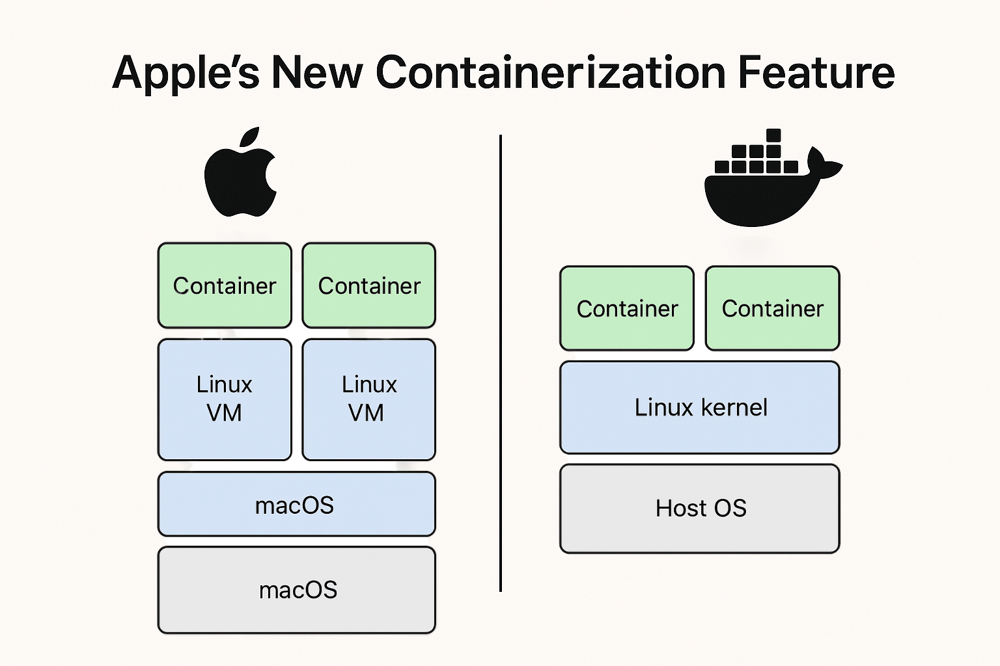

# Apple Containers vs Docker on macOS: Differences and Trade-offs

> **Reviewed October 31, 2026:** Updated against Apple’s [container 1.6.1 release](https://github.com/apple/container/releases/tag/1.6.1) and its versioned documentation. This revision clarifies the Docker Desktop comparison and networking behaviour. Apple’s documented requirements are Apple silicon and macOS 26; match the documentation to your installed release. This is a documentation review, not a performance benchmark.

Short version: Apple announced a native containerization stack for macOS that runs OCI images inside lightweight Linux virtual machines (VMs) using macOS virtualization APIs. It is built to be tightly integrated with macOS and Apple Silicon, and it is not a drop-in replacement for Docker in every environment – but for many Mac-first workflows, it’s a serious new option. 

* * *

## **What Apple actually released**

Apple introduced an open-source “container” tool and a Containerization framework for macOS that can create and run OCI-compatible Linux container images on Macs. The implementation is written in Swift and leverages macOS’s virtualization framework so that each container runs inside a lightweight Linux VM rather than sharing the macOS kernel directly. See Apple’s [versioned project documentation](https://github.com/apple/container/blob/1.6.1/README.md) and [technical overview](https://github.com/apple/container/blob/1.6.1/docs/technical-overview.md). 

* * *

## **Technical difference – Apple’s approach versus a typical Docker approach**

### **1) Kernel model**

*   **Docker (typical Linux containers):** containers share the host kernel. Containers are lightweight because they reuse the kernel – isolation is achieved via namespaces, control groups (cgroups), seccomp, AppArmor, SELinux, etc.
*   **Apple Container:** runs each Linux container inside its own lightweight VM that has its own Linux kernel. That means kernel-level isolation between containers and between container and host. 

### **2) Runtime and plumbing**

*   **Docker:** relies on container runtimes (runc/containerd) and a daemon (dockerd). On macOS, Docker Desktop runs Linux containers inside a Linux VM. Its [supported virtual machine managers](https://docs.docker.com/desktop/features/vmm/) include Apple’s Virtualization framework. The useful distinction here is a shared Linux VM versus Apple’s VM-per-container approach, rather than whether either tool uses macOS virtualization.
*   **Apple Container:** integrates with Virtualization.framework, vmnet, Keychain, and other macOS services. It runs OCI-compatible images using its own VM-per-container runtime rather than Docker Engine inside a shared Linux VM. 

### **3) Integration and ecosystem**

*   **Docker:** broad cross-platform ecosystem, mature CLI, Compose, Kubernetes integrations, swarm and third-party tooling. Offers a familiar workflow across platforms, but host networking, file mounts, CPU architecture, and VM resource limits can differ. Test those boundaries rather than assuming identical behaviour.
*   **Apple Container:** aims to be OCI-compatible (so images and registries are compatible), but the tool is deeply integrated with macOS features (Keychain for secrets, XPC for IPC, vmnet for networking), making it first-class on macOS but macOS-specific in behaviour. 

* * *

## **Pros of Apple’s approach**

1.  **Stronger isolation at the kernel level** – each container gets its own kernel, which reduces risk from kernel exploits and lateral movement between containers. This is similar philosophically to Kata Containers and Firecracker, but native to macOS. 
2.  **Native macOS integration** – tools can plug into Keychain, vmnet, XPC and other macOS services in a straightforward way, improving secrets management and IPC semantics for macOS-native developer workflows. 
3.  **Designed for Apple Silicon** – Apple’s Virtualization framework and M-series chips provide a first-party path for running the lightweight VMs. Performance should be measured against the actual alternative and workload rather than assumed from the implementation.
4.  **OCI compatibility** – you can pull and run standard OCI images, so registries and container images remain usable. That lowers friction for devs who already use container images. 
5.  **A different isolation boundary** – a VM per container can reduce some shared-kernel risks. It does not make arbitrary untrusted code safe; mounts, credentials, networking, host integrations, and project maturity remain part of the threat model.

* * *

## **Cons and tradeoffs**

1.  **Higher per-container resource overhead** – a separate lightweight VM per container usually costs more memory and some CPU compared to kernel-sharing containers. The gap may be small on Apple Silicon, but it exists in principle. Some virtualization features (like dynamic memory ballooning) are limited, which affects scaling and memory efficiency. 
2.  **Maturity and ecosystem gaps** – Docker, containerd and Kubernetes have years of ecosystem work, plugins, debugging tools, monitoring integrations and community knowledge. Apple’s stack is new; some edge cases, networking behaviours and tooling gaps remain to be ironed out. 
3.  **Possible macOS lock-in** – because Apple uses macOS-specific services and virtualization features, certain integrations or workflows might not behave identically off-Mac. While OCI images remain portable, operational behaviours and tooling may diverge. 
4.  **Networking and multi-container communication caveats** – IP connectivity, DNS naming, and published ports are separate concerns. Check the networking details below before moving a multi-container workflow. 
5.  **Not a replacement for Linux servers** – server fleets and production Kubernetes clusters run on Linux. Apple’s macOS containerization solves Mac-local developer experience and secure local execution, not replacing server-side container runtimes. 

* * *

## **When to choose Apple’s container approach over Docker (practical guidance)**

Choose Apple Container on your Mac when you care about one or more of the following:

*   You want a **VM-per-container isolation model** and have assessed the host data, credentials, and network access the workload will receive.
*   You want **first-party support on Apple Silicon** with direct integration into macOS frameworks.
*   You are a macOS-native developer or team and desire a **native, Apple-supported workflow** for running OCI images locally without Docker Desktop.
*   You need to run Linux tools on macOS but prefer using **Apple’s system management** for networking, credentials, and UI integration.

Stick with Docker when:

*   Your target environment is **Linux servers, cloud VMs or Kubernetes**; Docker/containerd/K8s behaviours on Linux are the canonical production environment.
*   You rely on mature Docker ecosystem features – Compose, Swarm, third-party plugins, and established CI/CD integrations.
*   You need very fine-grained resource efficiency per-container for large numbers of small containers where shared-kernel efficiency matters.

* * *

## Apple container networking: what works and what to check

In Apple’s [1.6.1 networking guide](https://github.com/apple/container/blob/1.6.1/docs/networking.md), containers receive an IP address reachable from the Mac and other containers on the same network. Name resolution needs additional configuration; IP connectivity alone does not establish that service names will resolve.

- **Container names:** The guide documents a configured DNS domain and a macOS resolver entry. Domain-qualified names on the default network are supported. Bare-hostname discovery on custom networks is a documented limitation in this release; use the documented IP-based approach where needed.
- **Localhost access:** Publish a port when you want a service exposed through a host port. A loopback binding keeps that entry point local to your Mac.
- **Separate networks:** Check which network each container joins. Do not assume containers on different networks can communicate.

Before replacing a Docker Desktop workflow, test service discovery, host access, mounts, image architecture, and the orchestration features you actually use. OCI image compatibility does not make every Compose workflow interchangeable.

* * *

## **Migration and coexistence strategy – a practical blueprint**

1.  **Start local with Apple Container for development testing** – use Apple’s tool for macOS-first development, but validate images on Linux CI runners or staging to catch platform differences.
2.  **Keep CI/CD and production on Linux tooling** – build and push OCI images from either tool, but run integration tests on Linux hosts or Linux-based runners that match production.
3.  **Test networking and volume semantics** – run your app’s multi-container stack and confirm network behaviour, service discovery and volume persistence match expectations; rewrite any host-dependent scripts. 
4.  **Measure resource usage** – if many small containers are needed, benchmark memory and startup times and compare to a Docker-on-Linux baseline.
5.  **Threat-model sensitive local runs** – use the VM boundary deliberately, mount only required data, scope credentials, and verify whether the tool's current limitations fit the workload.

* * *

## **Example starting point (where to look)**

Apple’s open-source repo and docs are the primary source to get hands-on – the CLI is designed to consume and produce OCI images, and the repo includes usage docs and examples. Start with the [1.6.1 getting-started tutorial](https://github.com/apple/container/blob/1.6.1/docs/tutorials/start-here.md) and [command reference](https://github.com/apple/container/blob/1.6.1/docs/command-reference.md). For later versions, use the matching release documentation. 

* * *

## **Final verdict – when Apple’s container approach wins**

For Mac-first development and tight macOS integration, Apple’s containerization is an interesting option. It provides a first-party implementation for Apple Silicon and macOS plumbing. However, it does not obviate Docker or containerd in production Linux environments; portability, ecosystem maturity, and server-side performance still favour the established Linux runtime stack.

If I had to pick one plain rule: evaluate Apple Container for a Mac developer workflow, benchmark it against the tools you already use, and continue to validate production images in the Linux environment where they will run.

For the separate question of what software should be allowed to do, read [Runtime Isolation Is Not Governance](/content/2026/05/runtime-isolation-is-not-governance/). For delivery beyond a developer’s Mac, continue with [Why Deployment Should Be Boring](/content/2026/07/why-deployment-should-be-boring/).

And as always, StayFrosty!

~ James
