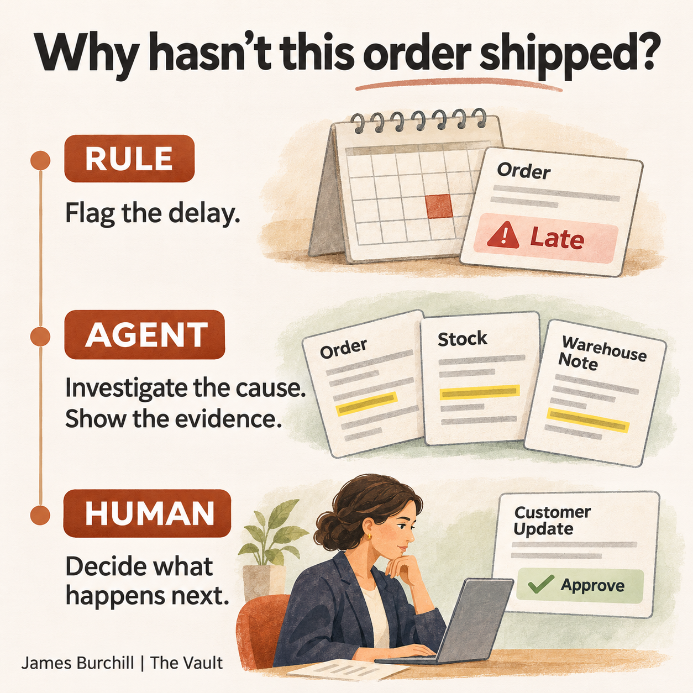

# Where Agentic AI Fits in a Business Process

In [Your Next Customer Might Send an AI Agent](/content/2026/11/your-next-customer-might-send-an-ai-agent/), I looked at how a customer’s assistant could get useful information from your business.

There’s another opportunity inside the business: helping your team investigate the questions that keep sending someone digging through multiple systems.

“Why hasn’t this order shipped?”

A rule can flag that the shipping date has passed. Finding out why might take someone ten minutes.

They open the order system. Check stock. Read the warehouse notes. Look for a customer email that changed the requirements.

Perhaps one item is holding up the shipment. Perhaps the stock exists but is allocated elsewhere. Perhaps the warehouse is waiting for clarification that someone already supplied in an email.

The answer may be scattered across those records. Assembling it takes work.

That’s where I’d test an AI agent.

Its job would be to follow the evidence across those records and explain what is blocking the order. What it finds determines what it checks next.

But the result has to be useful to the person reviewing it.

“Probably a stock issue” leaves them doing the investigation again.

“The warehouse note says the order is waiting for item B. The stock record shows none available, and the purchasing record lists a replenishment delivery for Thursday.”

That gives them something to check. It also separates the recorded facts from anything still uncertain. An expected replenishment date, for example, doesn’t establish when the customer’s order will ship.

The test is whether gathering that evidence this way makes the work quicker without making the answer less dependable.

Suppose your team investigates 40 delayed orders a week, taking ten minutes each. That’s six hours and 40 minutes.

If an agent gathers the evidence and brings human review down to two minutes per order, you recover five hours and 20 minutes a week. At $45 an hour, that represents $240 in staff capacity before build and running costs.

Those are illustrative numbers. Your actual volume, investigation time, and review effort determine whether there’s a worthwhile opportunity.

I’d start with five recent cases where you know what happened.

Use the records that would have been available at the time. Including a later note that explains the resolution would give the AI an answer your team didn’t have during the original investigation.

Prepare the information in an environment approved for the data involved. Then ask the AI to identify the blocker, cite its evidence, and state what it cannot establish.

Have the person who normally investigates these orders review the results.

Check whether it found the right cause, whether the records support its explanation, and how long verification takes. Include the time spent correcting mistakes or chasing missing evidence.

An answer that takes two minutes to read and another twelve minutes to untangle hasn’t saved anything.

Five cases are an initial screen. If the results look useful, try a broader set: split shipments, conflicting stock records, incomplete notes, and cases where the cause simply isn’t documented.

You want to know when it helps and when it should say, “There isn’t enough information here.”

Only then would I consider connecting it to live systems. Start with read-only investigation, keep customer updates under human approval, and measure the full effort involved—including maintaining the integration.

The most useful finding might be that you don’t need an agent yet. Perhaps a missing field or an unclear handoff causes most of the investigation work. Fixing that could be cheaper and more dependable.

Start with the recurring question. Establish what a useful answer looks like. Test whether AI reduces the effort required to reach it.

That gives you a business case you can examine.

Stay frosty.

J
